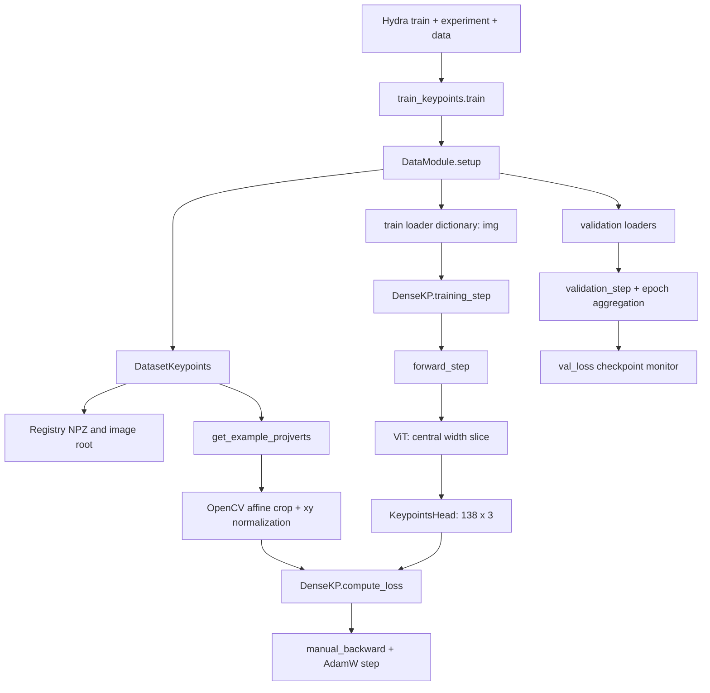

# DenseKP repository architecture

> **Post-audit implementation update (2026-09-28):** The archaeology below is a frozen
> report of baseline `8553ccd`. A subsequently authorized correctness/refactor batch
> is now present in the working tree. Current contracts, fixed/guarded issue IDs,
> configuration migration, verification evidence and remaining training gates are in
> [the implementation report](docs/refactor/DENSEKP_CORRECTNESS_20260928.md).
> Statements below that production code was unchanged refer to the archaeology phase;
> baseline bug descriptions and unchecked checklists are not the current fix status.

Audit baseline: `8553ccd2d3117755e595ae97c8522c303bd05ceb`, inspected 2026-09-28. This is an archaeology report, not an implementation proposal. Production sources were not changed. The companion reports are [DATA_FLOW.md](DATA_FLOW.md), [BUG_AUDIT.md](BUG_AUDIT.md), and [TRAINING_READINESS.md](TRAINING_READINESS.md).

## Scope and evidence

The tracked repository contains a DenseKP image-to-landmark trainer and a larger collection of synthetic-data preparation, rendering, and validation tools. It does **not** contain a complete original-BEDLAM-to-training conversion pipeline or a production inference/deployment application. Inference here consists of model `forward` plus diagnostic evaluation scripts using ground-truth crops. The subsequent authorized inspection of the separate `pano-stitch` checkout is recorded below; its source and local assets are additional evidence, outside this repository's baseline.

The review traced the training package, all reusable `src/densekp_retrain` modules, annotation adapters, motion and rendering paths, camera conversions, evaluator and smoke entry points, configuration, and tests. Scene/appearance/experiment tools were inventoried and their relevant geometry/import boundaries inspected; their artistic output and external asset contents were not exhaustively validated. Existing `docs/` reports were treated as historical leads and checked against source, not accepted as current specifications.

There are important differences between the commit and this machine:

- `assets/densekp_regressor_R.npy`, the BEDLAM downsample pickle, checkpoints, datasets, render outputs, `third_party/`, and most Hydra `data/` files are local ignored assets.
- The baseline tracks only `ds_multiperson_tiny.yaml` and `omni_near_erp_tiny.yaml` in the Hydra data group. The default `data/train.yaml` is absent from the commit.
- `assets_external/vitpose_backbone.pth` and `assets_external/densekp.ckpt` exist locally. Their presence is not a reproducible provisioning mechanism.
- No `AGENTS.md` was found in this repository/its searched parent tree. No delegation or production edits were performed.

## Components and ownership boundaries

These are inferred technical responsibility boundaries; the repository does not define corresponding human owners.

| Boundary | Implementation | Responsibility / output |
|---|---|---|
| Training entry | [densekp/train_keypoints.py](densekp/train_keypoints.py), `train`, `main` | Compose Hydra, save config, construct data/model, callbacks and Lightning trainer, fresh initialization or resume |
| Dataset registry | [densekp/core/configs/__init__.py](densekp/core/configs/__init__.py) | `DATASET_FOLDERS`, `DATASET_FILES=[val,train]`; Python globals are authoritative |
| Dataset adapter | [dataset_keypoints.py](densekp/core/datasets/dataset_keypoints.py), `DatasetKeypoints` | NPZ + image → normalized crop, original/cropped labels, affine metadata |
| Batching | [datamodule_keypoints.py](densekp/core/datasets/datamodule_keypoints.py), `DataModule` | Concatenate named datasets, shuffle training, one validation loader per dataset |
| Crop/augmentation | [datasets/utils.py](densekp/core/datasets/utils.py), `get_example_projverts` | OpenCV affine image warp and label transform, color augmentation, legacy joint-driven extreme crops |
| Model/loss/loop | [densekp_trainer.py](densekp/core/densekp_trainer.py), `DenseKP` | Backbone/head forward, actual DenseKP objective, manual AdamW optimization, validation metric |
| Backbone | [backbones/vit.py](densekp/core/backbones/vit.py), `vit`, `ViT` | Fixed ViTPose-H-shaped feature extractor |
| Prediction head | [heads/smpl_head_keypoints.py](densekp/core/heads/smpl_head_keypoints.py), `KeypointsHead`; [pose_transformer.py](densekp/core/components/pose_transformer.py) | One query token, cross attention, 414-value linear readout reshaped to 138×3 |
| Generic inherited losses | [losses.py](densekp/core/losses.py) | Several confidence-weighted joint/parameter losses; these are **not** the active DenseKP loss implementation |
| Body generation | [body/geometry.py](src/densekp_retrain/body/geometry.py), `tools/generate/` | Canonical SMPL-X inputs → mesh vertices and fixed-order surface landmarks |
| Annotation generation | `tools/annotation/`, [annotation/serialization.py](src/densekp_retrain/annotation/serialization.py) | Intermediate BEDLAM geometry or rendered labels → NPZ training contract |
| Camera mathematics | [camera/](src/densekp_retrain/camera/) | Omni-Radtan and Double Sphere projection/unprojection; camera poses and image LUTs |
| Rendering | `tools/render/`, `tools/fisheye/render_equirectangular*.py` | Blender geometry, RGB, depth, instance masks, analytical projections, manifests |
| Render orchestration | [rendering/jobs.py](src/densekp_retrain/rendering/jobs.py), `process.py`, [runtime/](src/densekp_retrain/runtime/) | Resolve Blender/appearance manifests, subprocess execution, output paths |
| Scene/appearance | [scene/spec.py](src/densekp_retrain/scene/spec.py), `tools/scene/`, `tools/experiments/`, `tools/visualize/` | Scene assets, placement and appearance audits/reviews; not model training modules |
| Evaluation/inference diagnostics | [evaluate_densekp_npz.py](tools/validate/evaluate_densekp_npz.py), [evaluate_omni_densekp.py](tools/validate/evaluate_omni_densekp.py) | Checkpoint → predictions/overlays and crop-space error; no detector or original-image prediction export |
| Regression verification | [tests/](tests/), `tools/validate/` | Camera math, selected stored geometry, masking examples, optional training/render smoke workflows |

`pyproject.toml` packages only `src/densekp_retrain*`. The sibling `densekp/` trainer is used from the checkout via import path setup. An editable install alone does not package the trainer. `requirements.upstream.txt` is an inherited dependency list, not a complete environment lock for all renderer and trainer tools.

## Training call graph



The data string called `DATASETS_AND_RATIOS` is split on underscores and used as a list of dataset names. There is no ratio parsing or weighted sampler. Sampling frequency follows concatenated dataset sizes. Dataset names consequently cannot contain underscores without being split.

`DataModule.train_dataloader()` returns `{'img': loader}`; `training_step` expects `joint_batch['img']`. Validation receives the sample batch directly. These differing batch wrappers are consistent with their callers.

Both backbone and head are optimized. The constructor always loads `VITPOSE_BACKBONE`, including during `load_from_checkpoint`. `init_checkpoint` initializes weights into a fresh run; `ckpt_path` is passed to Lightning `fit` for full-state resume. If both are set, construction loads the initialization checkpoint before Lightning resumes the other checkpoint.

Actual runtime settings in `train()` are one GPU, mixed precision, log interval 500; only `val_check_interval` and `max_steps` are read from the trainer configuration. CPU/MPS/DDP/device-count, validation limits, deterministic mode, and sanity-step settings in the YAML are not forwarded. `train`, `test`, and `seed` top-level options are not acted on as their comments suggest.

## Model architecture and objective boundary

At the default image size, `[B,3,256,256]` becomes `[B,3,256,192]` through `x[:,:,:,32:-32]`. ViT uses 16-pixel patches, 1280 channels, 32 blocks, 16 attention heads, and stochastic depth up to 0.55. `PatchEmbed` has padding 2 when `ratio=1`; its output is still 16×12 tokens. A learned positional tensor has 193 positions; the first position is added to every spatial token, not emitted as an extra output token. Output is `[B,1280,16,12]`.

The head flattens to `[B,192,1280]`. A zero input `[B,1,1]` passes through a learned embedding and learned position; six decoder layers use self attention, cross attention, and feed-forward blocks at dimension 1024. `dec_kp` outputs `[B,414]`, reshaped to `[B,138,3]`. The head is named `smpl_head_keypoints`, but it does not predict SMPL parameters or run SMPL-X.

The active loss is `DenseKP.compute_loss`, not the instantiated `Keypoint2DLoss` or `criterion_keypoints`. Prediction xy is square-crop-normalized. With `MODEL.with_var=True`, output channel 2 is trained as log sigma in a scaled squared-distance objective. With `False`, it is still emitted but receives no loss supervision. No calibrated confidence conversion or downstream score threshold is implemented here. See DATA_FLOW for the exact distinction from annotation channel 2 and the user's `keypoint_value` terminology.

## Generated-data call graphs

### Original BEDLAM records

```text
be_seq.csv + camera CSV + selected PNG names
  -> build_bedlam_tiny_frame_manifest.parse_state_machine/main
  -> person/frame manifest and required motion indices
  -> [missing tracked adapter: pose/placement/camera reconstruction]
  -> input NPZ: vertices, joints3d, camera_translation, intrinsics, orientation
  -> generate_bedlam_densekp.main
  -> R @ vertices; project_official; official_bbox
  -> write_bedlam_tiny_dataset
  -> DatasetKeypoints
```

The manifest script currently insists on exactly 24 PNGs. The annotation generator accepts 1–32 samples and excludes named portrait/closeup orientations. They are tiny audit tools, not a scalable full BEDLAM importer. The generator's term “official” describes its local formula; parity with the original data producer has not been proved end to end by this audit.

### Synthetic motion and images

```text
motion_seq.npz poses[T,165]
  -> load_real_smplx_motion: canonical parameters + selected source frame IDs
  -> generate_real_motion_geometry
  -> body.load_smplx_model -> vertices[T,10475,3]
  -> compute_densekp_3d(R, vertices) -> landmarks[T,138,3]
  + prepare_p0_dressed_geometry: explicitly checked clothing/frame pairing
  -> render_p0_blender -> RGB/depth/mask/camera-xyz/projected-xy/manifests
  -> finalize_p0_outputs -> depth state labels
  -> build_rendered_tiny -> train.npz / val.npz with channel 2 = 1
```

Toy/procedural motion entry points feed the same geometry contract. They are labeled as diagnostic geometry by their manifests and are not evidence of real motion diversity.

### Omni/Double Sphere/ERP branch

```text
geometry + per-person placement + camera_to_world
  -> render_equirectangular_source (Blender panorama, depth, instance IDs)
  -> run_fisheye_multiperson_pilot
       project_erp + erp_visibility -> ERP annotations
       warp_case -> Omni fisheye RGB/masks/annotations
  -> either original source ERP,
     build_omni_erp_pilot (actual Omni fisheye -> ERP), or
     build_ds_multiperson_pilot (source ERP -> DS fisheye -> delivery ERP)
  -> build_omni_multiperson_tiny
       per-person cyclic roll + mask bbox + binary supervision selection
  -> DatasetKeypoints
```

These three ERP sources have different imaging histories. The common NPZ adapter does not encode that distinction in the four required fields. Preserve their manifests. DS camera-specific yaw placements are explicitly not a synchronized stereo pair.

## Inference and deployment boundary

The two evaluators call `DenseKP.load_from_checkpoint`, `.eval()`, and `torch.inference_mode()`. The NPZ evaluator shares the loader/crop path with training, disables augmentation, and compares normalized xy in crop pixels. The paired Omni evaluator also uses `get_example_projverts`, with explicit 256 crop size; its bboxes come from rendered masks or visible GT extents.

No such detector, ONNX/TensorRT exporter, original-image keypoint restoration function, multi-camera matching consumer, or API carrying `keypoint_value` was found in this training repository. The external follow-up below identifies those implementations in `pano-stitch` and numerically compares preprocessing and restoration. It does not establish equality of network predictions across exported backends.

### External deployment follow-up: pano-stitch

Inspected read-only at `/mnt/hdd/yuyue/home/yuyue/Projects/pano-stitch`, HEAD `830dc51cce7467a99278a72d33ae3d9d8fffe5c2`, on 2026-09-28. This is a **working-tree inspection**: sequence orchestration, fitting adapters and other files already had local changes. Core `src/densekp_delivery` files were tracked and clean at inspection; `tools/CameraHMR` model/export code and assets are local additional dependencies. Selected source hashes are in DATA_FLOW section 10. No external files were changed. `lib_pano/delivery_bootstrap.py` defaults to the in-repository package but permits `DENSEKP_DELIVERY_ROOT` overrides; an actual launch must freeze its resolved package.

| Boundary | External implementation | Verified role |
|---|---|---|
| Pair delivery | `src/densekp_delivery/pipeline.py::run_pipeline` | DS fisheye → **normal ERP** → overlap ROI → detector/person crops → 138 points → full ERP → cross-camera matching |
| Formal sequence | `src/script/human_fitting/run_densekp_track_guided_sequence.py`, `human_fitting/sequence_orchestrator.py` | Accepts already prepared **normal ERP** frames and masks; alternates full detection and track-guided person boxes, with recovery/identity gates |
| Camera/ROI | `densekp_delivery/camera/{fisheye_equirect,ds_camera_params,erp_rotate}.py`, `overlap_roi.py` | DS calibration groups, periodic ROI extraction, full-ERP restoration; sphere rotation for output/fitting |
| Detector/runner | `densekp_delivery/runners/{ort_runner,trt_runner,pytorch_runner}.py` | Separate person detector, one DenseKP prediction per supplied bbox; TRT inherits ORT crop/decode helpers |
| Model export | `tools/CameraHMR/deploy/densekp_onnx/export_densekp_onnx.py::DenseKPONNXWrapper` | `[B,3,256,256]` → internal width slice `32:-32` → `[B,138,3]` |
| Matching/schema | `densekp_delivery/person_match.py`, `schema.py` | Spherical geometry assignment; fixed semantic row IDs and explicit geometric validity; no third-channel confidence weighting |
| Fitting boundary | `src/lib_pano/fitting_io/{densekp_delivery_boundary,track_guided_delivery,densekp_runtime_export}.py` | Normal-ERP predictions → ERP_ROTATE pairs → selected 138 IDs and 204 supporting SMPL-X vertices for C++ fitting |
| Final output | `src/lib_pano/fitting_io/correspondence_output.py` | Optimized correspondence output by default; optional raw predictions; ERP_ROTATE/ERP/fisheye coordinate choices with validity/CPW masks |

```text
DS fisheye pair -> normal ERP images + lens-valid masks
  -> overlap component ROI -> YOLOX bbox -----------+
previous matched observation -> guided ERP bbox --+-> square 256 RGB tensor
  -> DenseKP (internally 256x192) -> 138 xy + raw third values
  -> inverse square affine -> ROI-local xy -> full normal ERP (periodic x)
  -> cross-camera matching / identity gates
  -> rotate xy rays into ERP_ROTATE -> per-person SMPL-X staged-LM fitting
  -> optimized correspondences -> requested output space -> valid/CPW filters
```

Thus multi-person handling is distributed across detection, crop-conditioned single-person DenseKP, assignment and tracking. The user has limited this task to DenseKP given an existing target-person box: landmark accuracy, target-person attribution within crowded crops, and robustness to distortion/occlusion. Missing detections are outside scope; matching/tracking/fitting remain contextual consumers with fixed implementations. **ERP_ROTATE is not the DenseKP input in these inspected production paths.** Historical scripts that run CameraHMR on other raster orientations must not redefine this contract.

The guided path requires a successful preceding fit but obtains its crop extent from `track.last_person.pairs` / `.valid`, the previous **matched observation**. It deliberately avoids using potentially collapsed optimized projections as the body envelope. This is verified at the caller, despite the helper docstring's reference to projected body keypoints.

The user subsequently fixed the target scene to **20260320_riding_dataset3**, using the **20260320/new** calibration. `data_process/Output/config.json` maps that path under the misleadingly generic key `dataset4`; its `dataset3` key actually refers to `20260320_riding_dataset2`. Resolve datasets by full source path and camera group, not the short config key. The located 4325–4575 prepared regression window and the separate 0311 calibration boundary are documented in DATA_FLOW section 11.

The real-scene follow-up distinguishes three artifact boundaries: per-camera runner output before matching, matched `raw_pairs` after sphere rotation but before fitting, and `optimized_pairs` after fitting. The inspected sequence JSON preserves only matched raw pairs; guided proposal metadata also need not identify the assigned candidate's actual source crop. These are evaluation provenance limits (R12/R13), not evidence of a broken affine. DATA_FLOW section 12 records a visual review of 106 single-camera panels using raw pairs, with downstream fitting kept outside the DenseKP target.

## Verification coverage and architectural limits

All 18 existing tests passed on this machine, including optional stored perspective/fisheye baselines and measured DS mask coverage. Those tests do not execute full DenseKP inference/training, audit all annotation rows, verify raw BEDLAM reconstruction, test mirrored landmark identities, or compare a deployed inference implementation.

Small CPU probes additionally checked the loader and affine inverse, a flip counterexample, masked NaNs, empty validation aggregation, zero-worker loader configuration, camera-domain handling, and baseline-only Hydra composition. No training experiment, Blender render, checkpoint load into the full model, asset download, or external deployment run was performed. The audit findings and their evidence limits are recorded separately in BUG_AUDIT.

After that initial pass, a follow-up checked every local candidate NPZ row and reconstructed the synthetic SMPL-X body/landmark/projection chain using the available body model on CPU. It did not run the DenseKP network. See [DATA_FLOW section 9](DATA_FLOW.md#9-follow-up-candidate-contract-verification) for results, hashes, and the newly quantified missing-motion inputs on the original BEDLAM route.
