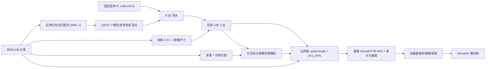

# BEDLAM / BEDLAM2 可行性与转换方案

## 可行性结论

如果样本能够提供相机坐标系中可恢复的 SMPL-X 几何信息（参数及与之匹配的人体模型/拓扑）、经过标定的相机投影、图像关联信息和人物身份信息，那么 BEDLAM 足以用于生成训练数据。已有 RGB 图像配合已经投影好的完整 SMPL-X 顶点也能满足要求。

当前 CameraHMR 仓库展示了 BEDLAM/BEDLAM2 的图像与标注注册方式，但不包含 DenseKP 标注生成器或本地标注，因此可下载版本中具体包含哪些字段，在实际检查数据归档前仍为 **未知（UNKNOWN）**。

## 需要提取的字段

最低限度的几何字段包括：

- 图像/帧路径以及人物/序列 ID；
- SMPL-X 全局朝向、身体姿态、形状参数 betas 和平移；性别/模型变体及确切的 10,475 顶点拓扑；如果表情、手部或下颌参数会改变 138 行算子涉及的任意顶点，也必须保留这些参数；
- 相机内参（`fx,fy,cx,cy`，若偏斜系数不为零也需保留）、外参和坐标系约定，以及图像宽度/高度；
- 渲染后的 RGB 图像及人体边界框，或足以推导该边界框的数据。

强烈建议同时保留人物实例分割、深度/z-buffer、逐人物的可见性/遮挡信息、截断信息和原始渲染元数据。分割和深度不是 DenseKP 的训练目标，但它们是可靠判断各表面点是否可见的依据。

## 转换流程

## 是否需要重新渲染？

如果发布的 RGB 图像、精确相机参数和可恢复的 SMPL-X 顶点彼此对齐，那么建立首个透视域基线不需要重新渲染。如果这些数据不对齐或不可用、无法重建可靠的逐点可见性，或者需要主动生成带有几何精确标注的鱼眼/ERP 域 RGB 图像，则必须重新渲染。

对透视图像进行二维变形可作为一种有效的数据增强手段，但它无法生成源视场之外的内容，在处理遮挡和接缝时也不如重新渲染可靠。

## 各类域问题的处理环节

| 问题 | 数据集生成 | 数据增强 | 模型重训练 |
|---|---:|---:|---:|
| 精确透视投影和 z-buffer 可见性 | 主要处理环节 | 不处理 | 使用掩码 |
| 真实鱼眼/ERP 射线、接缝环绕、极点采样 | 最终保真度的主要环节 | 可进行近似试验 | 从样本中学习 |
| 与生产环境检测器一致的裁剪/边界框策略 | 生成元数据 | 对尺度/平移加入扰动 | 无需修改网络结构 |
| 模糊、压缩、颜色、曝光和传感器噪声 | 可选渲染 | 主要处理环节 | 学习鲁棒性 |
| 中等程度的径向畸变/视场变化 | 可选 | 有帮助 | 学习鲁棒性 |
| 遮挡/截断 | 准确渲染和标注 | 可选合成遮挡 | 使用掩码损失 |
| ERP 水平周期性 | 生成跨接缝样本 | 循环平移 | 仅在基线失败时重新考虑网络结构 |

首先使用未经修改的网络。先建立与原透视监督一致的基线，再加入相机域数据和可见性感知损失。不要让投影错误与网络结构实验相互混杂。

## 使用前必须完成的实现

1. 检查有代表性的 BEDLAM/BEDLAM2 记录，明确记录单位、坐标轴、左右手系、相机约定和拓扑；
2. 通过投影已知关节/顶点来复现一帧渲染结果，要求叠加结果达到像素级一致；
3. 应用 `assets/densekp_regressor_R.npy`，验证全部 138 个点及其可见性；
4. 生成一个小型 NPZ，并使用 `tools/annotation/inspect_annotation.py` 验证；
5. 只有在测量并确认上游第 3 通道的行为后，才能加入可见性感知损失。
