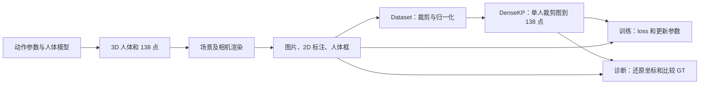

# 从哪里开始读这个项目

更新：2026-09-29，包含当前未提交的场景诊断与遮挡点监督改动。
这是当前实现的阅读入口。旧 `CURRENT_CODE_MAP.md` 和根目录考古报告有各自的历史基线，
其中的旧问题描述不能直接当作现在的行为。

遮挡点为何参与 loss、镜头外点为何排除，见
[遮挡点监督与评价](training/OCCLUDED_SUPERVISION_20260929.md)。读 Dataset 时可同时打开
[keypoint_supervision.py](../densekp/core/keypoint_supervision.py)，这里集中定义了监督条件。

## 1. 先把项目看成三部分

**生成数据、训练模型、检查模型。** 它们共享坐标和关键点约定，但承担不同职责。



这里的“单人”指**每次指定一个目标框**，不保证裁剪里面只有一个人。
当前 forward 只读取图像张量，框通过裁剪决定输入内容；人物 ID、相机参数、实例 mask
没有作为额外条件传入模型。这是理解最近“换框后预测变化”的关键。

## 2. 各目录负责什么

| 目录 | 你可以怎样理解 | 第一轮读到什么程度 |
| --- | --- | --- |
| `densekp/` | 实际神经网络、Dataset、loss、训练入口 | 需要读主线 |
| `src/densekp_retrain/` | 数据生成共用库：人体几何、相机、EXR、资产路径 | 先读调用到的函数 |
| `tools/generate/` | 从动作准备几何文件的命令入口 | 知道输入/输出 |
| `tools/fisheye/` | ERP、鱼眼和双路场景生成；部分共用逻辑仍在脚本里 | 跟当前场景链读 |
| `tools/validate/` | 加载检查、推理、训练冒烟、各种诊断实验 | 先选一个实际实验 |
| `tools/render/`、`tools/scene/` | 透视渲染及场景资产制作等其他路径 | 第二轮按需读 |
| `tools/annotation/` | 标注适配与检查，包括 BEDLAM 路径 | 不等同于所有数据的唯一入口 |
| `tools/experiments/`、`tools/visualize/` | 其他实验和可视化工具 | 有调用关系时再深入 |
| `configs/hydra/` | 模型训练及数据选择配置 | 与训练入口一起读 |
| `configs/*.json` | 场景/相机等工具配置，各自由对应脚本消费 | 找实际读取者 |
| `assets/`、`assets_external/` | 场景、映射矩阵、权重等本地资产 | 看使用位置及约定 |
| `outputs/`、`datasets/` | 生成和评估的数据制品 | 用于验证理解，不能当作源代码 |
| `tests/` | 已固定的数值和行为约定 | 读相关模块时配合看 |
| `docs/` | 架构、历史实验、当前导读 | 注意文档日期及基线 |
| `third_party/`、`scripts/` | 外部工具和下载/环境辅助 | 当前主线外按需追踪 |

`densekp` 与 `densekp_retrain` 是两个用途不同的 Python 包名。当前 `pyproject.toml`
只打包 `src/densekp_retrain*`；许多工具另外把仓库根目录加到 `sys.path`，才能 import
`densekp.core` 和 `tools.*`。这说明运行路径也是现有组织方式的一部分。

## 3. 第一轮只沿这条顺序读

先读 [一份实际样本的完整旅程](SAMPLE_WALKTHROUGH.md)，再按下面顺序打开代码。
函数名是定位锚点；文件中的其他分支可先放下。

| 顺序 | 文件及定位 | 读完应能解释 |
| --- | --- | --- |
| 1 | [dataset_keypoints.py](../densekp/core/datasets/dataset_keypoints.py)，`__init__`、`__getitem__` | 一行 NPZ 怎样变成一张目标裁剪和 138 个标签 |
| 2 | [datasets/utils.py](../densekp/core/datasets/utils.py)，`get_example_projverts`、`generate_image_patch_cv2` | 图像和标签怎样共用 affine；颜色与坐标各自如何归一化 |
| 3 | [crop_geometry.py](../densekp/core/crop_geometry.py)，`normalize_crop_xy`、`restore_crop_xy` | 怎样从裁剪坐标回到原图；为什么不加 32 像素 |
| 4 | [densekp_trainer.py](../densekp/core/densekp_trainer.py)，`forward_step` | 模型真正读了哪些字段，192 宽在哪里产生 |
| 5 | [smpl_head_keypoints.py](../densekp/core/heads/smpl_head_keypoints.py)，`KeypointsHead.forward` | 图像特征怎样变成 `[B,138,3]`，无需先精读 attention 数学 |
| 6 | [keypoint_objective.py](../densekp/core/keypoint_objective.py) | 标签第三值与预测第三值为什么不同；训练 loss 与验证误差为什么不同 |
| 7 | [train_keypoints.py](../densekp/train_keypoints.py) 和 [datamodule_keypoints.py](../densekp/core/datasets/datamodule_keypoints.py) | 数据、模型、优化器、验证、checkpoint 怎样被组织起来 |
| 8 | [evaluate_ds_occlusion_control.py](../tools/validate/evaluate_ds_occlusion_control.py)，`main` | 不训练时如何复用同一 Dataset 和模型，固定框与评分集合在哪里定义 |

第一次先理解 1–4，确认能讲清“框→图像输入→输出坐标”，再进入 loss 和训练。
之后才精读 [ViT](../densekp/core/backbones/vit.py) 和
[TransformerDecoder](../densekp/core/components/pose_transformer.py) 内部层结构。

## 4. 第二轮：往上追数据从哪来

当前诊断的生成调用链是：

```text
run_ds_occlusion_control.main
  ├─ 读取既有 street pilot 的 rig.json / people.json
  ├─ 修改前景人物布局，固定目标和相机
  ├─ subprocess → Blender → render_equirectangular_source.main
  │    └─ RGB、Depth、IndexOB、source_manifest.json
  └─ run_ds_scene_pair_pilot.process_scene
       ├─ world_points / point_in_view / erp_visibility
       ├─ double_sphere 的投影和反投影采样表
       └─ normal ERP、138 点、可见性、实例框、配对统计
```

从 [run_ds_occlusion_control.py](../tools/fisheye/run_ds_occlusion_control.py) 进入即可。
这里一部分代码在普通 Python 中运行，一部分在 Blender 的 Python 中运行；看到
`subprocess` 时要跟进传给 Blender 的脚本，而不只是继续往下读父进程。

再向上是 `load_real_smplx_motion.py` → `generate_real_motion_geometry.py` →
`src/densekp_retrain/body/geometry.py`。这条链生成网格顶点和 DenseKP 3D 点。
当前实验复用已生成的 39 帧几何，没有每次重新运行 SMPL-X。

BEDLAM 原始 RGB 标注适配是另一条需要独立核验的路径。不能因为当前重新渲染的样例
对齐，就认定全部原始 BEDLAM 图片、相机、人体和 DenseKP 索引已经一一对应。

## 5. 第三轮：配置、其他路径和部署边界

- `configs/hydra/train.yaml` 组合 data、trainer、experiment、paths；当前默认 data 是
  `unselected`，正式训练要显式选择数据。诊断脚本的 `audit_cfg` 是另一套明确关闭增强的配置。
- `densekp/core/configs/__init__.py` 的注册表把数据集名字映射为图片根目录和 NPZ。
  `DATASET_FILES[False]` 是验证/诊断标签，`[True]` 是训练标签；两者由 bool 索引列表取得。
- `DATASETS_AND_RATIOS` 这个历史名字容易误导：当前 DataModule 是选择数据集并拼接，
  没有按名字所暗示的比例采样。
- 网络结构目前主要由 `backbones/vit.py` 和 `constants.TRANSFORMER_DECODER` 构造；
  不要以为改 YAML 中某个同名结构参数就一定修改了模型，要找实际读取者。
- `init_checkpoint` 是权重初始化，`ckpt_path` 是恢复训练状态；二者不能同时设置。
- 当前代码提供训练与 Python 诊断，实际检测、跨相机重建、合图及部署逻辑在外部项目。
  本轮不会把它们混入 DenseKP 重构。

## 6. 哪些地方值得后续整理

下面是从实际代码看到的候选，不是本轮已经实施的修改：

| 可读性问题 | 具体证据 | 适合的整理方向 | 保留的验证 |
| --- | --- | --- | --- |
| 诊断脚本重复加载模型和构造 Dataset | `evaluate_ds_scene_pair.py`、`evaluate_ds_occlusion_control.py`、`evaluate_ds_box_control.py` | 抽出小的推理/样本加载共用模块，实验脚本保留各自干预和评分规则 | 相同输入原始预测、框和 affine |
| 脚本兼作库，依赖方向不好找 | control renderer import pilot 的 `process_scene`；box evaluator import control evaluator 的工具和依赖 | 把稳定的共用行为放入库，从定义模块直接导入依赖 | 世界点、图像映射、可见 mask 与标注一致 |
| 单个函数同时负责很多阶段 | pilot 的 `process_scene` 包含投影、重映射、框、存储、画图 | 按输入输出清楚的阶段拆开，明确数组含义 | 图像/标签数值对照 |
| 配置与硬编码交叉 | 本地 geometry 路径、相机参数、YAML 与结构常量 | 集中实验输入参数，明确实际生效的配置 | 默认试验可复现，结构和权重兼容 |
| 辅助函数大文件及长行难读 | `datasets/utils.py`、Blender renderer | 先分段/命名/注释，再按调用关系迁移 | 裁剪与标签变换不变 |
| 当前说明混在历史文档里 | 旧地图、README 的阶段记录 | 设当前入口，并标清历史记录 | 链接和陈述与当前代码一致 |

推荐先整理诊断工具的重复部分，再考虑生成链；不借可读性重构更改 loss、点索引或相机
数学。每次行为改变应独立说明和验证。**本轮只增加导读和文档入口。**
