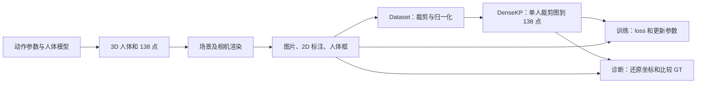

# 从哪里开始读这个项目

更新：2026-10-02，已接入 Blender 共用装配和 DS/Omni 成像后处理和人体/衣物/坐标相机公共计算，以及来源/打包/框、Dataset、评价与训练回调。
这是当前实现的阅读入口。旧 `CURRENT_CODE_MAP.md` 和根目录考古报告有各自的历史基线，
其中的旧问题描述不能直接当作现在的行为。

遮挡点为何参与 loss、镜头外点为何排除，见
[遮挡点监督与评价](training/OCCLUDED_SUPERVISION_20260929.md)。读 Dataset 时可同时打开
[keypoint_supervision.py](../densekp/core/keypoint_supervision.py)，这里集中定义了监督条件。

当前重构进度见 [执行任务与验收门槛](refactor/IMPLEMENTATION_TASKS_20261001.md)。
P1 的指标、配置、推理、评价展示和训练回调归位已完成；
P1–P3 已整体通过评审并提交于 aaf08bd；P4 安装、入口和历史清理已整体通过评审。P4/P5 随本次提交交付；[P5 最终阅读与交付核查](refactor/P5_READING_DELIVERY_20261002.md) 已完成，待评审决定整体收尾。推荐命令及计算边界见 [命令表](COMMANDS.md)。
场景和透视路径从 [配方 → 资产 → 消费入口索引](rendering/SCENE_RECIPE_INDEX.md) 进入；框实验配额与随机配方继续由实验入口负责。

## 1. 先把项目看成三部分

**生成数据、训练模型、检查模型。** 它们共享坐标和关键点约定，但承担不同职责。



这里的“单人”指**每次指定一个目标框**，不保证裁剪里面只有一个人。
当前 forward 只读取图像张量，框通过裁剪决定输入内容；人物 ID、相机参数、实例 mask
没有作为额外条件传入模型。这是理解最近“换框后预测变化”的关键。

## 2. 各目录负责什么

| 目录 | 你可以怎样理解 | 第一轮读到什么程度 |
| --- | --- | --- |
| `densekp/` | 实际神经网络、Dataset、loss、训练入口 | 需要读主线 |
| `src/densekp_retrain/` | 数据生成公共库及应用评价：人体几何、相机、EXR、资产路径、候选汇总 | 先读调用到的函数 |
| `tools/generate/` | 从动作准备几何文件的命令入口 | 知道输入/输出 |
| `tools/fisheye/` | ERP、鱼眼和双路场景生成；部分共用逻辑仍在脚本里 | 跟当前场景链读 |
| `tools/validate/` | 加载检查、推理、训练冒烟、各种诊断实验 | 先选一个实际实验 |
| `tools/render/`、`tools/scene/` | 透视渲染及场景资产制作等其他路径 | 第二轮按需读 |
| `tools/annotation/` | 标注适配与检查，包括 BEDLAM 路径 | 不等同于所有数据的唯一入口 |
| `tools/experiments/`、`tools/visualize/` | 其他实验和可视化工具 | 有调用关系时再深入 |
| `configs/hydra/` | 模型训练及数据选择配置 | 与训练入口一起读 |
| `configs/*.json` | 场景/相机等工具配置，各自由对应脚本消费 | 找实际读取者 |
| `assets/`、`assets_external/` | 场景、映射矩阵、权重等本地资产 | 看使用位置及约定 |
| `outputs/`、`datasets/` | 生成和评估的数据制品 | 用于验证理解，不能当作源代码 |
| `tests/` | 已固定的数值和行为约定 | 读相关模块时配合看 |
| `docs/` | 架构、历史实验、当前导读 | 注意文档日期及基线 |
| `third_party/`、`scripts/` | 外部工具和下载/环境辅助 | 当前主线外按需追踪 |

`densekp` 与 `densekp_retrain` 是两个用途不同的 Python 包，由同一个 distribution 提供 editable 安装。
`setup.py` 只发现两个源码根；tools 保留仓库脚本方式，跨 cwd 用绝对脚本路径。
依赖分组、实测版本、路径基准及安装验收见 [开发安装与入口](environment/INSTALLATION.md)。

## 3. 第一轮只沿这条顺序读

先读 [一份实际样本的完整旅程](SAMPLE_WALKTHROUGH.md)，再按下面顺序打开代码。
函数名是定位锚点；文件中的其他分支可先放下。

| 顺序 | 文件及定位 | 读完应能解释 |
| --- | --- | --- |
| 1 | [dataset_keypoints.py](../densekp/core/datasets/dataset_keypoints.py)，`__init__`、`__getitem__` | 一行 NPZ 怎样变成一张目标裁剪和 138 个标签 |
| 2 | [crop_pipeline.py](../densekp/core/datasets/crop_pipeline.py)，`determine_crop`、`transform_crop`，再读 [image_processing.py](../densekp/core/datasets/image_processing.py) | 增强怎样改变框，图像和标签怎样共用 affine；颜色与坐标怎样归一化 |
| 3 | [crop_geometry.py](../densekp/core/crop_geometry.py)，`normalize_crop_xy`、`restore_crop_xy` | 怎样从裁剪坐标回到原图；为什么不加 32 像素 |
| 4 | [densekp_trainer.py](../densekp/core/densekp_trainer.py)，`forward_step` | 模型真正读了哪些字段，192 宽在哪里产生 |
| 5 | [smpl_head_keypoints.py](../densekp/core/heads/smpl_head_keypoints.py)，`KeypointsHead.forward` | 图像特征怎样变成 `[B,138,3]`，无需先精读 attention 数学 |
| 6 | [keypoint_objective.py](../densekp/core/keypoint_objective.py) | 标签第三值与预测第三值为什么不同；训练 loss 与验证误差为什么不同 |
| 7 | [train_keypoints.py](../densekp/train_keypoints.py) 和 [datamodule_keypoints.py](../densekp/core/datasets/datamodule_keypoints.py) | 数据、模型、优化器、验证、checkpoint 怎样被组织起来 |
| 8 | [evaluate_ds_occlusion_control.py](../tools/validate/evaluate_ds_occlusion_control.py)，`main` | 不训练时如何复用同一 Dataset 和模型，固定框与评分集合在哪里定义 |

读 Dataset 时，[loading.py](../densekp/core/datasets/loading.py) 负责显式 `annotation_path`、`image_root` 与旧 ID 回退；
名称仍保留日志、返回字段及 portrait/closeup 分支含义。
[augmentation.py](../densekp/core/datasets/augmentation.py) 返回具名随机参数；
`CropPlan` 表示最终中心与裁剪参数，`CropResult` 表示图像、标签和 affine。
旧 utils/legacy 裁剪导入、tuple 接口与 SMPL/HMR 裁剪能力已退役；可视化、BEDLAM validator 和现行裁剪契约直接引用公共定义。
两个旧评分 CLI 已移除；Omni 生成、相机数值回归和当前候选评价保留，不能把新旧评分分母视作等价。详见 [B2b 退役验收](refactor/PRUNING_B2B_RETIREMENT_20261003.md)。
Dataset 验收工具的历史 capture 与测试辅助 original=True 已明确退役，verify 继续使用独立原基线；见 [本批迁移验收](refactor/PRUNING_B2B_CROP_MIGRATION_20261003.md)。
实测输入、增强和 RNG 对照见 [P2.1/P2.2 验收](refactor/P2_DATASET_CROP_20261002.md)。

读第 8 步时，从公共定义追踪三件事：

- [datasets/configuration.py](../densekp/core/datasets/configuration.py) 的 `audit_cfg` 生成关闭增强的独立 YACS 配置。
- [evaluation.py](../densekp/core/evaluation.py) 定义 GT 分组、周期误差、预测拒绝计数和严格 `summarize`。
- [evaluation/candidates.py](../src/densekp_retrain/evaluation/candidates.py) 定义候选 `summary` 和 `aggregate`，
  输出按点/按人两套统计。非有限值仍计入分母，返回失败状态及 null；严格 `summarize` 则报错。

旧 validate 模块保留这些函数的导入兼容，新调用应直接使用上述公共模块。

读有界训练实验时，更新前梯度检查与参数探针已在
[training_audit.py](../densekp/core/training_audit.py)：`CheckUpdates` 记录更新尝试，
`probes` 保存 backbone/head 各自首个参数的最多 4096 个 float32 标量。
它们不代表全部参数已更新；实际完成步数仍由调用方核查。
`train_source_isolated_trial.RunAudit` 直接继承公共类；`FixedValidation` 位于
[training/trial_callbacks.py](../src/densekp_retrain/training/trial_callbacks.py)。
从 `on_train_batch_end` 读触发步数、eval/FP32、参数/步数/RNG 检查、保存和 train 的顺序，
再读 `_evaluate_rows` 的固定样本评分。异常停止及默认空 callback state 保持原行为。

候选评价从 [evaluate_candidate_baseline.py](../tools/validate/evaluate_candidate_baseline.py) 的 main 进入：
先看 [candidate_inputs.py](../src/densekp_retrain/evaluation/candidate_inputs.py) 的输入冻结，
再看 [candidate_runner.py](../src/densekp_retrain/evaluation/candidate_runner.py) 的
`read_candidate → compare_reference → predict_candidate → score_candidate → save_candidate`，
最后看 [candidate_reporting.py](../src/densekp_retrain/evaluation/candidate_reporting.py) 和
[pairs.py](../src/densekp_retrain/evaluation/pairs.py) 的分组与分母。
点图与拼图在 [visualization/keypoints.py](../src/densekp_retrain/visualization/keypoints.py)，
JSON 策略在 [io/json.py](../src/densekp_retrain/io/json.py)。旧 evaluator 导出只用于历史兼容。

推理共用操作在 [inference.py](../densekp/core/inference.py)：两种严格加载路径保留各自初始化顺序；
`predict_batch` 保持模型当前模式并返回原始 tensor，shape/非有限处理仍由评价入口决定。
`predict_item` 保留旧 smoke 的 eval 副作用和有限输出检查；source trial 直接调用，smoke 旧名兼容导出。

第一次先理解 1–4，确认能讲清“框→图像输入→输出坐标”，再进入 loss 和训练。
之后才精读 [ViT](../densekp/core/backbones/vit.py) 和
[TransformerDecoder](../densekp/core/components/pose_transformer.py) 内部层结构。

## 4. 第二轮：往上追数据从哪来

先沿“来源 → 样本 → 衍生框 → 监督标签”读四步：

1. [source_split.py](../src/densekp_retrain/data/source_split.py)：声明来源隔离，再检查每个 scene 中所有人物，
   包括没有目标框的遮挡者，最后汇总集合与 paired-box 签名。
2. [packing.py](../src/densekp_retrain/data/packing.py)：按冻结 index 的 loader_input/loader_row 取样，
   保留字段/行序；原始 198/79 行不因框派生而改变。
3. [prepare_box_robustness.py](../tools/experiments/prepare_box_robustness.py)：从旧日志取 400 次 parent_row，
   按原 seed/配额生成提议，调用 [boxes.py](../src/densekp_retrain/data/boxes.py) 做坐标计算及拒绝检查，
   经真实 Dataset 裁剪后检查支持量，再回退或接纳。公共计算不决定实验配额。
4. [keypoint_supervision.py](../densekp/core/keypoint_supervision.py)：新标签在实际完整裁剪后重算监督；
   旧权重仅原样装配。适配层与 Dataset 消费的 [keypoint_contract.py](../densekp/core/keypoint_contract.py)
   一起读，不能仅凭第三列的数值猜测其语义。

具体数据关系和保持的历史策略见 [样本导读第 3.1 节](SAMPLE_WALKTHROUGH.md#31-来源样本衍生框与监督标签)，
本批证据见 [P2.3–P2.5 验收](refactor/P2_SOURCES_BOXES_20261002.md)。


随后沿“姿态参数 → 人体与衣物 → 世界坐标 → 相机标签”读：

- [body/parameters.py](../src/densekp_retrain/body/parameters.py) 的 `PARAMETERS/evaluate/zero_pose/rest_body`，
  配合 [body/geometry.py](../src/densekp_retrain/body/geometry.py) 的 138 行 regressor。
- [clothing/shells.py](../src/densekp_retrain/clothing/shells.py) 的两种衣片方案，以及
  [clothing/binding.py](../src/densekp_retrain/clothing/binding.py) 的三角形/重心绑定；款式和材质留实验层。
- [body/transforms.py](../src/densekp_retrain/body/transforms.py) 的 `world_points`：衣物、人体、点共用身体 lift。
- [camera/rig.py](../src/densekp_retrain/camera/rig.py)、[erp.py](../src/densekp_retrain/camera/erp.py)、
  [domain.py](../src/densekp_retrain/camera/domain.py)、[visibility.py](../src/densekp_retrain/camera/visibility.py)：
  camera-to-world、射线距离、周期坐标、显式有效域和可见性分开读。

几何见 [P3.1/P3.2 验收](refactor/P3_GEOMETRY_CAMERA_20261002.md)。成像后处理已归入公共模块，
已有 EXR 的 CPU 回放见 [P3.3 验收](refactor/P3_IMAGING_20261002.md)；
两条代表路径的真实装配/渲染对照另见 [P3.4 验收](refactor/P3_BLENDER_20261002.md)。

当前诊断的生成调用链是：

```text
run_ds_occlusion_control.main
  ├─ 读取既有 street pilot 的 rig.json / people.json
  ├─ 修改前景人物布局，固定目标和相机
  ├─ subprocess → Blender → render_equirectangular_source.main
  │    └─ RGB、Depth、IndexOB、source_manifest.json
  └─ densekp_retrain.imaging.ds.process_scene
       ├─ world_points / point_in_view / erp_visibility
       ├─ double_sphere 的投影和反投影采样表
       └─ normal ERP、138 点、可见性、实例框、配对统计
```

成像部分按以下模块读：

1. [source.py](../src/densekp_retrain/imaging/source.py)：读原始 EXR 距离/实例；DS RGB 用保存的源预览，Omni 用线性 EXR RGB。
2. [ds.py](../src/densekp_retrain/imaging/ds.py) 的 `process_scene`，或 [omni.py](../src/densekp_retrain/imaging/omni.py) 的 `warp_case`：显式组合重映射、有效域、点标签、框与保存步骤。
3. [remap.py](../src/densekp_retrain/imaging/remap.py)：DS 周期采样；Omni 保留自己的 constant-border 历史规则。
4. [visualization/imaging.py](../src/densekp_retrain/visualization/imaging.py)：点预览不参与有效域和监督判定。

DS 源可见性预检查仍在重映射前，避免改变异常时的部分输出；Omni 仍先保存基础图像，再检查人物 ID。
这些执行顺序有独立基线，不能为了统一流程悄悄调整。

从 [run_ds_occlusion_control.py](../tools/fisheye/run_ds_occlusion_control.py) 进入即可。
这里一部分代码在普通 Python 中运行，一部分在 Blender 的 Python 中运行；看到
`subprocess` 时要跟进传给 Blender 的脚本，而不只是继续往下读父进程。

Blender 部分保留两个明确入口：

- [render_equirectangular_source.py](../tools/fisheye/render_equirectangular_source.py)：打开原生场景、读取多人、地面/绑定检查，保留 native 灯光和人物 ID。
- [render_equirectangular_scene_source.py](../tools/fisheye/render_equirectangular_scene_source.py)：空场景读取对象、添加 SUN/HDRI，保留单人身体 1/衣物 2 的历史策略。

两者直接调用 [assembly.py](../src/densekp_retrain/rendering/blender/assembly.py) 的网格、相机、compositor 和渲染循环。
皮肤/衣物材质在 [materials.py](../src/densekp_retrain/rendering/blender/materials.py)，
发型曲线在 [groom.py](../src/densekp_retrain/rendering/blender/groom.py)，
场景读取在 [scene_bridge.py](../src/densekp_retrain/rendering/blender/scene_bridge.py)。
这些子模块需要 Blender 的 bpy；纯衣物校验 [contracts.py](../src/densekp_retrain/clothing/contracts.py) 只依赖 NumPy。
导入 rendering 包本身不拉入 bpy/Torch，也没有让两个 renderer 互相调用。

再向上是 `load_real_smplx_motion.py` → `generate_real_motion_geometry.py` →
`src/densekp_retrain/body/geometry.py`。这条链生成网格顶点和 DenseKP 3D 点。
当前实验复用已生成的 39 帧几何，没有每次重新运行 SMPL-X。

BEDLAM 原始 RGB 标注适配是另一条需要独立核验的路径。不能因为当前重新渲染的样例
对齐，就认定全部原始 BEDLAM 图片、相机、人体和 DenseKP 索引已经一一对应。

## 5. 第三轮：配置、其他路径和部署边界

- `configs/hydra/train.yaml` 组合 data、trainer、experiment、paths；当前默认 data 是
  `unselected`，正式训练要显式选择数据。公共配置工厂 `audit_cfg` 是另一套明确关闭增强的配置，不能与模型配置混为一份。
- `densekp/core/configs/__init__.py` 的注册表把数据集名字映射为图片根目录和 NPZ。
  `DATASET_FILES[False]` 是验证/诊断标签，`[True]` 是训练标签；两者由 bool 索引列表取得。
- `DATASETS_AND_RATIOS` 这个历史名字容易误导：当前 DataModule 是选择数据集并拼接，
  没有按名字所暗示的比例采样。
- 网络结构目前主要由 `backbones/vit.py` 和 `constants.TRANSFORMER_DECODER` 构造；
  不要以为改 YAML 中某个同名结构参数就一定修改了模型，要找实际读取者。
- `init_checkpoint` 是权重初始化，`ckpt_path` 是恢复训练状态；二者不能同时设置。
- 当前代码提供训练与 Python 诊断，实际检测、跨相机重建、合图及部署逻辑在外部项目。
  本轮不会把它们混入 DenseKP 重构。

## 6. 区分核心、配方、兼容与历史

B2 精简的当前边界见 [整体交付检查表](refactor/PRUNING_B2_COMPLETION_20261003.md)。
`constants.py` 仅保留活动模型/辅助关节常量；训练配置使用 Hydra 与 `dataset_config`，
旧 `_C/default_config` 和 misc 的三个历史工厂/取指标接口已退役。注册表与 `to_lower` 保留。

| 类型 | 怎样辨认 | 阅读方式 |
| --- | --- | --- |
| 核心实现 | densekp/core 的 Dataset/objective/inference；densekp_retrain 的几何/相机/成像/评价 | 新调用直引定义模块；前五节就是阅读主线 |
| 实验配方 | tools/experiments、tools/scene 和具体渲染/标注入口 | 保留布局、配额、灯光、随机参数；按你的任务选择一个入口，不通读全部脚本 |
| 兼容与退役边界 | 剩余工具包装按具体入口维护 | B1 旧 loss/train_utils、B2b 旧裁剪/评分接口已退役；现行 Dataset 仍支持旧 NPZ 权重，训练仍读 keypoint_objective |
| 历史记录 | docs/refactor、旧代码地图、早期阶段报告与历史 outputs | 查来源和验证边界时读，不能以当时状态覆盖当前实现 |

[B1 精简报告](refactor/PRUNING_B1_20261002.md) 记录当前已退役接口；[此前保留表](refactor/LEGACY_RETENTION_20261002.md) 是上轮状态；[配置索引](../configs/README.md) 区分当前与继承配置。
日常运行 `bash scripts/audit_workspace.sh`，需要 Dataset/历史合约时加 `--model-contracts`。
默认检查不读真实权重、不遍历 outputs；完整旧实验回放仍需其明确的资产与版本条件。

P1–P3 完成；公共数据包忽略问题已在 aaf08bd 修复。安装、清理与 P5 文档随本次提交交付。
P5 已完成实际样本走读与交付核查，当前停止于最终评审；P4/P5 随本次提交交付，未提前标记整个重构通过。
