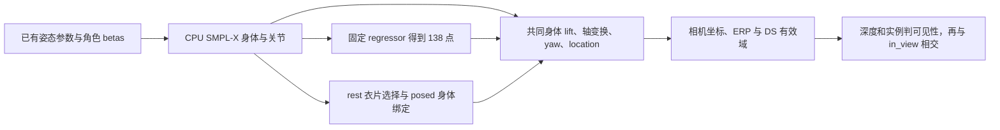
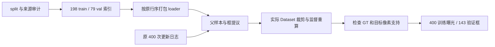
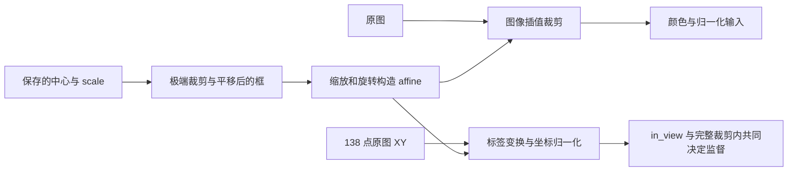

# 跟着一个样本读完整条链

配合 [阅读地图](READING_GUIDE.md) 使用。主例是已保存的街景 **heavy / cam2 / 人物 3**，
采用 09-29 的遮挡监督标签，复用 09-28 的图像与模型预测；不是当前新训练样本。
P5 只回读选定 NPZ、数组头和 manifest，没有重跑模型、Dataset 或渲染。

先沿第 0–7 节读主线；第 1.1 节的骑行人物、第 3.1/4.1 节的来源隔离与框增强是另两条路径，
用于解释当前公共计算，不能当成主例的来源。训练入口见第 8 节，主例未参加训练。

### 主例的产物与代码索引

以下路径前缀：`G=outputs/baselines/temporal_case_aaron_1095`；
`S=outputs/experiments/ds_occlusion_control_20260928`；
`A=outputs/experiments/ds_occlusion_amodal_20260929`。路径均相对仓库根。

| 环节 | 当前实现（打开后查此符号） | 实际产物/已核对信息 |
| --- | --- | --- |
| 人物与姿态 | [load_real_smplx_motion.main](../tools/generate/load_real_smplx_motion.py) | `G/geometry/canonical_motion.json`：BEDLAM `rp_aaron_posed_009/1095`，male，动作切片内帧 80 → 几何帧 16 |
| 人体/语义点 | [generate_real_motion_geometry.main](../tools/generate/generate_real_motion_geometry.py)、[compute_densekp_3d](../src/densekp_retrain/body/geometry.py) | `G/geometry/geometry_manifest.json`、`vertices.npy`、`faces.npy`、`densekp_3d.npy`；保留 source translation |
| 衣物 | [prepare_p0_dressed_geometry.main](../tools/generate/prepare_p0_dressed_geometry.py)、[原生多人入口](../tools/fisheye/render_equirectangular_source.py) | `G/clothing_geometry/clothing_manifest.json` 及 clothing 数组；本例是 BEDLAM 既有衣物模拟，不是第 1.1 节外壳配方 |
| 世界/场景/相机 | [world_points](../src/densekp_retrain/body/transforms.py)、[rig_poses](../src/densekp_retrain/camera/rig.py)、[assembly](../src/densekp_retrain/rendering/blender/assembly.py) | `S/heavy/people.json`、`rig.json`、`source/source_manifest.json`；urban_street_assets，1536×768 ERP |
| 成像、有效域和标签 | [process_scene](../src/densekp_retrain/imaging/ds.py) | `S/heavy/source/cam2.exr`、`cam2/normal_erp.png`、`pair_annotations.npz`、`cam2/boxes.json`；历史版本边界见第 2 节 |
| 固定框/监督标签 | [evaluate_ds_occlusion_control.main](../tools/validate/evaluate_ds_occlusion_control.py)、[make_targets](../densekp/core/keypoint_supervision.py) | `S/clear/cam2/boxes.json` → `A/fixed_boxes.json` → `A/heavy/fixed_box_loader.npz` 第 1 行 |
| 裁剪与监督 | [DatasetKeypoints.__getitem__](../densekp/core/datasets/dataset_keypoints.py)、[determine_crop / transform_crop](../densekp/core/datasets/crop_pipeline.py) | `A/heavy/cam2_person_3.npz` 保存 target/affine；完整输入与增强基线另见第 4.1 节，不声称本 NPZ 含完整输入 |
| 模型与 loss | [DenseKP.forward_step / compute_loss](../densekp/core/densekp_trainer.py)、[keypoint_loss](../densekp/core/keypoint_objective.py) | `A/model_config.yaml`、`loader_config.yaml`、`report.json` 指向原 checkpoint；主例只有预测，没有训练 loss 制品 |
| 还原与评价 | [restore_crop_xy](../densekp/core/crop_geometry.py)、[point_errors / evaluation_masks](../densekp/core/evaluation.py) | `A/heavy/cam2_person_3.npz` 原始/ERP 预测与误差，`A/report.json` 对应 case；新候选入口从 [evaluate_rows](../src/densekp_retrain/evaluation/candidate_runner.py) 读 |

**追溯边界：** 原动作文件、衣物来源、模型目录、regressor 和场景路径在本机存在。
`geometry_manifest.json` 的旧 `outputs/temporal_case_aaron_1095/geometry/canonical_motion.npz` 引用已不存在；
当前 `G/geometry/canonical_motion.npz` 存在，但没有旧副本可证明搬迁前字节一致，不能悄悄改写历史 manifest。
源渲染 manifest 没有冻结全部贴图/HDRI 版本或权重内容指纹，不能仅凭路径证明它们自渲染日起从未变化。
这些限制不阻断阅读保存产物，也不构成从任意干净机器重建同一历史图像的承诺。
详细只读证据见 [P5 报告](refactor/P5_READING_DELIVERY_20261002.md)。

## 0. 先确定我们要跟踪谁

选择 **heavy 条件、cam2、人物 3**，即被前景人物遮挡的后方目标。

```text
原图：outputs/experiments/ds_occlusion_control_20260928/heavy/cam2/normal_erp.png
标签：outputs/experiments/ds_occlusion_amodal_20260929/heavy/fixed_box_loader.npz
预测：同一 amodal 目录下 heavy/cam2_person_3.npz（复用旧预测）
```

此 loader NPZ 有 5 行，当前人物是第 2 条样本（索引 1）：cam2 的人物 2/3/4，以及 cam4
的人物 2/3。**一个样本是一张图中的一个指定人物**，因此多个样本可以共享同一张原图。
cam4 的人物 4 在 clear 条件下没有实例框，没有对应样本。

## 1. 138 个标签从哪里来

先看 [body/geometry.py](../src/densekp_retrain/body/geometry.py) 的 `compute_densekp_3d`：

```python
densekp_3d = np.einsum('kv,tvc->tkc', regressor, vertices)
```

这句话表示：每一帧，用 `R[138,10475]` 把 SMPL-X 的 `V[10475,3]` 映射为 138 个 3D 点。
`R` 每一行决定一个语义点由哪些人体网格顶点构成；它与 BEDLAM 的关节数组不是同一种索引。

当前几何来自 `outputs/baselines/temporal_case_aaron_1095/geometry/`：

| 数组 | 当前形状 | 含义 |
| --- | --- | --- |
| `vertices.npy` | `[39,10475,3]` | 39 帧人体网格，最后一维是 xyz |
| `faces.npy` | `[20908,3]` | 每个三角形的三个顶点索引 |
| `densekp_3d.npy` | `[39,138,3]` | 每帧 138 个语义点 xyz |

人物 3 使用几何帧 16，`motion_params.npz` 中对应动作切片内帧 80。
衣物 manifest 的 local_motion_indices[16]=80、source_frame_30fps[16]=181，后者含 start_frame=101；
不要把切片索引 80 和原始时间轴索引 181 混用。此资产的 manifest 记录
`source_translation_used=true`。当前 adapter 支持 poses `[T,165]` 的完整 SMPL-X
axis-angle；是否使用 source translation 由生成时的参数决定，不可概括为总是置零。

接着看 [world_points](../src/densekp_retrain/body/transforms.py)：几何点从人体的轴
约定转换到 Blender 世界轴，按身体最低点抬到地面，再应用 yaw 和位置。渲染器给 body
和 clothing 应用对应的物体变换。本例人物位置 `[1.8,0.3,0]`、yaw=90°，三个条件不变。

这些 3D 点是生成标注用的。DenseKP forward 本身没有输入这些点或 SMPL-X 参数。

### 1.1 从已有骑行姿态到公共几何计算

另一条已验收路径是 F01 女性、M01 男性各自的两种独立 COCO 骑行姿态，
位于 `cycling_four_characters_20260929/derivatives/`；本批只回读既有参数，不生成新资产。
[body/parameters.py](../src/densekp_retrain/body/parameters.py) 的 `evaluate` 按 PARAMETERS 顺序
将参数转成 CPU float32，调用本地 SMPL-X，返回身体 `[T,10475,3]` 与关节 `[T,J,3]`。
姿态是轴角弧度，平移与顶点是米；`zero_pose` 用负的 shaped pelvis 作为平移，使参考骨盆归零。
这是该角色系列的策略，不能据此改写上面保留 source translation 的旧时间序列。



[clothing/shells.py](../src/densekp_retrain/clothing/shells.py) 保留两条方案：整面选衣片后偏移，
以及在 rest 三角形内裁剪并保存重心对应。后者每个衣物顶点都有 `body_barycentric_indices[N,3]`
和 `body_barycentric_weights[N,3]`，其参考位置是同一 posed 身体三角形的加权和。
这些索引属于身体网格顶点，不是 138 点编号。profile 改覆盖范围，材质和款式配方仍在实验入口。

`world_points` 按 `(x,-z,y)` 把模型 +Y 向上转换为世界 +Z 向上；用身体最低 Y 做 lift，
再旋转和平移。调用衣物/138 点变换时必须传入同一身体 vertices，不能各自按最低点贴地。
这批四组合的身体、138 点和衣物重算与原资产误差均为 0；它验证计算，不代表重新验收 Blender 装配。

## 2. 3D 世界怎样变成带标注的图片

看 [render_equirectangular_source.py](../tools/fisheye/render_equirectangular_source.py)
和 [process_scene](../src/densekp_retrain/imaging/ds.py)。

1. Blender 打开街景，把固定的人体放入场景；两相机分别从各自光心渲染完整 ERP。
2. 渲染出 RGB、Depth 和 IndexOB。IndexOB 是人物实例 ID，用于区分身体属于谁。
3. `process_scene` 用同一世界点计算投影，并按各自 DS 相机做 ERP→鱼眼→normal ERP。
4. 图像再应用该相机的有效区域 mask。黑色有效区之外没有可用观测。
5. 同时保存各相机 xy、可见状态、实例 mask 和由实例像素得到的框。

对象装配的稳定计算现位于 [rendering/blender/assembly.py](../src/densekp_retrain/rendering/blender/assembly.py)：
创建 mesh/object → 绑定对应材质、衣物和 groom → 设置共享世界变换 → 创建 ERP 相机与 compositor → 渲染各相机。
[materials.py](../src/densekp_retrain/rendering/blender/materials.py) 和 [groom.py](../src/densekp_retrain/rendering/blender/groom.py)
保留已有 shader/曲线策略；原生场景加载、灯光与逐人物检查继续由入口组合。
历史链接单人入口保留另一套场景/灯光和实例 ID，不能直接替换成多人配方。
两条代表路径已做实际 Blender 世界网格和有限像素对照，见 [P3.4 验收](refactor/P3_BLENDER_20261002.md)；
这不代表所有资产组合都已经验收。场景配方与执行边界见 [配方索引](rendering/SCENE_RECIPE_INDEX.md)：
本例的街景先由 `build_urban_street.py` 制作基底，再由 `upgrade_urban_street_assets.py` 使用 apartment kit 和 Hidden Alley 道具升级为 `urban_street_assets.blend`；
`configs/fisheye_scene_urban_street_assets.json` 引用它，候选 DS 配方再把人体布局交给原生多人渲染入口。
公共 `rendering/jobs.py` 组织的是另一条历史透视路径，不是本例 ERP 的场景制作器。
P3.5 已分离四个场景脚本的导入与 main，核查命令/路径及 Blender 导入，没有重新制作这些资产。

上述样例描述的是原有产物。当前 `process_scene` 还在鱼眼阶段应用真实参考图提取的
镜头遮罩：同时裁 RGB 和实例图，并将其映射至 ERP，与已有有效区取交集后再判定
`in_view` / `visible`。新产物目录和对比结果见 [DS 镜头遮罩更新](rendering/DS_LENS_MASK_20260928.md)。

公共 [rig_poses](../src/densekp_retrain/camera/rig.py) 同时给出 normal ERP 与物理 DS 的 camera-to-world。
对行向量世界点，相机坐标为 `(world - camera[:3,3]) @ camera[:3,:3]`；列轴是右、下、前。
[project_erp](../src/densekp_retrain/camera/erp.py) 返回像素与 `norm(camera_point)`，后者是射线距离，
不是 optical-Z 深度。经度接缝可得到 x=0 或 x=width，消费方各自处理周期边界。

[point_in_view](../src/densekp_retrain/camera/domain.py) 使用 DS 几何域、鱼眼边界及显式 mask；
[erp_visibility](../src/densekp_retrain/camera/visibility.py) 则在原始源 ERP 深度/实例图上用周期 5×5 邻域
和 `<4 cm` 距离差判断表面可见。旧 DS 的实例邻域规则、Omni 后处理内的深度规则保留各自实现，
不能把规则互换，也不能从 RGB 黑色判断无效区。

成像主流程现在直接从 `imaging/ds.py` 或 [imaging/omni.py](../src/densekp_retrain/imaging/omni.py) 阅读：
读取源数据 → 准备采样表并重映射 → 应用显式有效域 → 生成标签与框 → 保存与预览。
DS 保留原先在重映射前计算源可见性和 roundtrip 预检查的顺序；Omni 保留先保存基础图像再检查人物 ID 的顺序。

注意深度的阶段：DS `SourceERP.ray_range_m` 是原始 EXR 的 ERP 射线距离，本流程不生成新的 depth.npy。
Omni `OmniBuffers.ray_range_m` 是 nearest 重映射并清理非有限值后的鱼眼距离，写入 `depth.npy`；
其 5×5 可见性判定在鱼眼上进行。二者均以米为单位，均不是 optical-Z，不能互换。
独立完整制品对照见 [P3.3 验收](refactor/P3_IMAGING_20261002.md)。

ERP 是经纬度展开的二维图片；这里 normal ERP 是当前 DenseKP 使用的图像栅格。
物理 DS 相机光轴相反，但两路 normal ERP 的虚拟轴向对齐。cam4 的翻转在 DS 投影映射中
处理，不能再额外翻一次图片或坐标。此处的 0.18 m 光心间距是合成试验参数。

区分三个状态：

- `in_view`：投影满足模型域、传感器范围及有效区条件；不说明是否被别人遮挡。
- `surface_visible`：用深度和人物实例 ID 检查表面可见性。
- `visible = in_view & surface_visible`：近似可见点，用于把误差分组；新版同时评价遮挡点。

现有表面检查是源 ERP 的 5×5 邻域、4 cm 距离容差；它是近似规则。本例 cam2 人物 3
有 123 个点落入有效视野，但 heavy 条件只有 22 个被判为可见。

## 3. 从图片和标注，构造一行 Dataset 输入

看 [evaluate_ds_occlusion_control.py](../tools/validate/evaluate_ds_occlusion_control.py)
的 `fixed` 和 `targets` 构造。它从 clear 条件取框，之后冻结：

```text
原图框 xyxy（右下不包含） = [1081, 325, 1183, 503]
center = [(1081+1183)/2, (325+503)/2] = [1132, 414]
方形裁剪边长 = max(102, 178) × 1.2 = 213.6 原图像素
scale = 213.6 / 200 = 1.068
```

这里的 `scale` 是“像素边长除以 200”的存储约定，不是置信度，也不是增强时的随机倍率。
实例框转为 center/scale 是这个 adapter 做的；Dataset 接收时已经是 center/scale。

NPZ 有这些字段：

| 字段 | 整个 NPZ 形状 | 人物 3 样本（索引 1）的意义 |
| --- | --- | --- |
| `imgname` | `[5]` | `cam2/normal_erp.png`，相对图像根目录 |
| `center` | `[5,2]` | `[1132,414]`，normal ERP 像素 |
| `scale` | `[5]` | `1.068` |
| `proj_verts` | `[5,138,3]` | 原图 x、y 和明确生成的二值监督 mask |

文件名 `proj_verts` 容易误导：此处只有 138 个语义点，不是全部 10475 个网格顶点。
人物 ID 用于脚本对应行和实例；这个 NPZ 没把 ID 当作网络特征输入。

原始 09-28 NPZ 的二值 mask 选择可见点。新版额外保存标量
`supervision_policy='in_view_full_crop'`、`in_view[5,138]`、`visible[5,138]`
以及人物/相机 ID。其第三列选择 **有效视野内且落在完整裁剪中的 GT**，遮挡不使其归零。
本例 cam2 人物 3 的监督点由 22 个变为 123 个，其中 101 个被判为遮挡。

### 3.1 来源、样本、衍生框与监督标签

完整来源隔离小试采用另一套冻结索引：`source_isolated_pilot_20260930` 的
`split_v2.json`、`train_index.json`、`val_index.json`，有 198/79 行。
[source_split.validate_split](../src/densekp_retrain/data/source_split.py) 先核查人物、外观和姿态来源，
再读取每个 scene 的 `people.json`；所有渲染人物都要属于同一划分，包括没有目标框的遮挡者。
同一图片及双相机场景不能跨 train/val。旧 omni 按相机或人物划分仅为 smoke，不等同于这种来源隔离。

每一行 index 的 `loader_input` 与 `loader_row` 指向原标注，`image` 指向原 RGB。
[pack_index_rows](../src/densekp_retrain/data/packing.py) 按这个顺序提取 center、scale、138 点、in_view、visible、
人物和相机字段，将 imgname 写为原图绝对路径；不复制整套 RGB，不重排索引。
入口 [build_source_isolated_trial.py](../tools/annotation/build_source_isolated_trial.py) 再用实际 Dataset 回读核查。

框增强小试在这些样本上派生输入：



[prepare_box_robustness.py](../tools/experiments/prepare_box_robustness.py) 读取旧训练日志中的 400 个父行号，
保持原顺序，仅把框策略按 seed 930 分配到这些曝光。配额仍由该实验定义：200 reference、100 center、
50 scale、50 single_edge。公共 [boxes.py](../src/densekp_retrain/data/boxes.py) 负责移动、缩放、单侧裁剪和
center/scale 计算；当前 change_box 仅按合成 **1536×768** 栅格截断，不是所有真实图像的通用裁剪规则。

派生行保留 `parent_row`、`parent_index`、`parent_bbox_xyxy`、人物/姿态来源及同一原图；
400 行表示 400 次曝光，不是 400 个独立身份或图像。验证选定的 18 个目标观测提出 144 个框，
现有支持量 gate 拒绝一个，保留 143 行。训练候选失败则回退到原框，原框仍失败就停止。

新标签先保留原 XY 和 in_view，或者由 `make_targets` 预计算固定框监督；声明新 policy 的 Dataset
都在实际 affine 后重算 `in_view & inside_full_crop`。可靠但遮挡的点继续监督。
旧权重不强行换成此策略：legacy 常数/可见性标签保持原值，commuter-studio 保持诊断用途。
打包时的空监督与框实验的最低支持量是不同规则，不能统一过滤。

实际 `challenge_001` 的框与标签变化见下文 4.1；本批独立 before/after 和历史元数据区别见
[P2.3–P2.5 验收](refactor/P2_SOURCES_BOXES_20261002.md)。

## 4. Dataset 怎样同时裁图和变换标签

打开 [DatasetKeypoints.__getitem__](../densekp/core/datasets/dataset_keypoints.py)。
它取出一行、恢复像素边长，然后依次读取、确定裁剪、变换和计算监督；
活动路径不再调用旧十项 tuple 包装 `get_example_projverts`。

数据源在 [loading.py](../densekp/core/datasets/loading.py) 中解析。例如，对本文遮挡监督版本（仓库根目录执行，需要 model 依赖；只读取数据，不运行模型）：

```python
from densekp.core.datasets.dataset_keypoints import DatasetKeypoints
from densekp.core.datasets.configuration import audit_cfg

dataset = DatasetKeypoints(
    audit_cfg("supervision_weight"),
    "occlusion-control",  # 保留名称；不必注册这个 ID。
    annotation_path="outputs/experiments/ds_occlusion_amodal_20260929/heavy/fixed_box_loader.npz",
    image_root="outputs/experiments/ds_occlusion_control_20260928/heavy",
    is_train=False,
    use_augmentation=False,
)
sample = dataset[1]
```

相对 `imgname` 拼接到 image_root；绝对 `imgname` 覆盖这个根目录。
不根据 NPZ 所在位置猜根目录，也不调用 resolve 改写原有路径。缺省的路径才查询旧 dataset ID 注册表。
名称仍用于返回的 `dataset`、日志以及 portrait/closeup 历史分支；路径显式化不取消这些用途。

先读 [crop_pipeline.py](../densekp/core/datasets/crop_pipeline.py) 的 `determine_crop`、`transform_crop`，
再按需进入 [image_processing.py](../densekp/core/datasets/image_processing.py)：

```text
read_image → 原图 BGR、原图尺寸
determine_crop → 增强参数、极端裁剪后的框、平移后的中心（CropPlan）
transform_crop
  → 抗锯齿/外观增强 → generate_image_patch_cv2 → 裁剪 BGR + affine[2,3]
  → normalize_image → RGB、float32 CHW、逐通道颜色和标准化
  → transform_labels → 辅助关节和 138 点共用 affine，再归一化 XY
Dataset._supervision → 根据变换后的 GT 重算监督，再返回原样本字段
```

本例 affine 约为：

```text
[[1.1985013, 0, -1228.70350],
 [0, 1.1985020, -368.179832]]
```

实际数值的微小差异来自 float32 框及 OpenCV affine 构造。记 `A` 为这个 2×3 矩阵：

```text
crop_pixel_xy = A @ [original_x, original_y, 1]
target_normalized_xy = crop_pixel_xy / [256,256] - 0.5
```

图像颜色归一化另有含义：实际先转换 float32 CHW，逐通道乘颜色倍率并 clip 到 0..255，
再按 `(channel - 255*mean) / (255*std)` 写回。不要把它与坐标归一化混淆。
标签也保留两次赋值：affine 得到的像素坐标先写入 float32 标签，再除以裁剪宽高并减 0.5。
把两步合为一个表达式会改变中间舍入，因此本次重构没有合并。

返回字典最值得关注的字段：

| 字段 | 单样本形状 | 用途 |
| --- | --- | --- |
| `img` | `[3,256,256]` | RGB 标准化后的模型输入 |
| `img_disp` | `[256,256,3]` | 未标准化 BGR 裁剪，用来画对照图 |
| `proj_verts` | `[138,3]` | 原图标签副本 |
| `proj_verts_cropped` | `[138,3]` | 归一化裁剪 xy，以及实际裁剪后的监督 mask |
| `_trans` | `[2,3]` | 原图到完整裁剪的 affine |
| `visible` | `[138]` | 已知的表面可见状态，不是 loss 权重 |
| `visibility_known` | `[138]` | 是否有明确的可见性元数据 |

affine 只变换 xy。旧 NPZ 的第三字段保持原样；声明了新版策略的 NPZ，则由 Dataset
根据**增强后的坐标**重新计算 `in_view & inside_full_crop`。因此平移或缩放后移出裁剪的点
不监督，移入的有效点可以恢复监督。完整裁剪的归一化范围是两轴 `[-0.5,0.5)`。
旧数据没有可见性元数据时，`visibility_known=false`，不能把它当作“全部遮挡”。

当前增强由 `is_train and use_augmentation` 决定；本例明确关闭。训练时尺度、平移、旋转
通过同一 affine 影响图像和点，颜色/降质增强作用于图像。水平翻转目前有保护性报错，
因为尚无验证过的 138 行左右置换；44 关节的置换不能代替它。

### 两个理解检查

**框中心右移会发生什么？** 保持方形边长 s、无旋转时，原图点的归一化坐标是
`(x-cx)/s, (y-cy)/s`。中心右移 Δx 后，同一点的标签 x 减少 `Δx/s`；图像也通过同一 affine 向左移动，
并引入新的右侧上下文。尺度改变会同时改变放大倍率和包含范围。模型接收的是变后的图像，不是框的数字或人物 ID。
这个公式用于解释，实际舍入与增强顺序仍以当前函数为准。

**为什么遮挡仍监督？** 本例保存的有效域内 123 点中，22 点可见、101 点遮挡；可靠 GT 均在完整裁剪内，
所以监督 123 点，域外 15 点不监督。旧 visible-only 标签仅 22 点，仍按旧契约读取。
新策略用 `in_view & inside_full_crop`，不再与 visible 相交；裁剪外点被排除，遮挡仅用于评价分组。
本例无裁剪外点，第 4.1 节的固定增强样本展示监督从 112 减到 102，补足裁剪截断情况。

### 4.1 当前框增强样本：框如何改变输入

查看裁剪展示时，从 [visualize_annotation.main](../tools/annotation/visualize_annotation.py) 顺着
`CropBox → crop_example → CropResult` 阅读：已读图像、源图像素中心/宽高、辅助点和
`proj_verts.copy()` 共同进入裁剪。`display` 是未归一化的 BGR 裁剪图，`dense_points` 是
完整裁剪坐标下的标签，`affine` 是二者共用的变换；`plan.box.width/height` 尚未乘增强 scale，
报告仍使用这两个宽高。该可视化入口自己处理 portrait/closeup 旋转，然后传 ndarray、dataset=None，
不在裁剪内部再旋转。低层归一化输入则在 `image` 字段；它与 display 的用途不同。

以下来自 P2 独立 before 的 `challenge_001`，并非重新推理的模型结果。
数据为 `box_robustness_400_20261001/data_v2/loader/val.npz` 第 1 行，图像属于合成
1536×768 ERP。其保存的 center 为 `[1110.760009765625, 405]`，scale 为
`1.6080000400543213`，恢复方形边长为 `scale*200 = 321.60000801086426` 像素。
若配置 BBOX_SHAPE，则先扩到该比例再取最大边；此样本没有额外比例扩展。



| 实际记录 | 关闭增强 | 固定 seed 930 的增强 |
| --- | ---: | ---: |
| 随机缩放倍率 | 1 | 0.8 |
| 旋转（度） | 0 | -33.8913182284 |
| 平移比例 tx / ty | 0 / 0 | 0.00451869254 / 0.00184875851 |
| 实际中心 | 1110.760010, 405 | 1112.213221, 405.594561 |
| in_view 点数 | 112 | 112 |
| 监督点数 | 112 | 102 |
| 其中遮挡点 | 71 | 68 |

平移是 `cx += width*tx`、`cy += height*ty`，之后 affine 使用 `width*随机倍率`、
`height*随机倍率` 和旋转角。这里随机缩放后的宽度约为 257.280006 像素；返回的
`box_size` 仍为缩放前的 321.600008，这是保留的历史字段语义，不能拿它当作全部增强后的视野宽度。

关闭增强时 affine 约为：

```text
[[0.796019659, 0, -756.186804],
 [0, 0.796019961, -194.388084]]
```

第 0 点的原图 XY `[1174.683228,315.733704]` 变为归一化 XY
`[0.198766172,-0.277569354]`；同一增强后的点为 `[0.396316528,-0.154534906]`。
图像和标签共用实际 affine；只重算 GT 是否落在完整 256-square 内，不依据模型预测挑点。
网络之后取中间 192 列，坐标仍属于完整方形，不额外加 32 px。
完整精度的参数与矩阵见 [样本记录](../outputs/acceptance/refactor_dataset_crop_20261001/walkthrough_sample.json)。

## 5. 模型怎样知道我们想预测谁

打开 [DenseKP.forward_step](../densekp/core/densekp_trainer.py)。核心只有这几步：

```python
x = batch['img']                         # [B,3,256,256]
features = self.backbone(x[:,:,:,32:-32]) # 输入 [B,3,256,192]
output = self.head(features)             # pred_keypoints [B,138,3]
```

当前 forward 没有读取人物 ID、bbox 数值、目标 mask、相机内参、另一视角或 GT。
目标的选择体现在**以谁为中心、包含怎样上下文的裁剪图像**里。这也是多人裁剪可能产生
歧义的地方。不能仅凭一个框来自人物 3 的实例 mask，就认为网络收到了“人物 3”这个身份。

模型继续向下：

| 阶段 | 张量形状（当前结构） | 做什么 |
| --- | --- | --- |
| ViT 输入 | `[B,3,256,192]` | 编码裁剪图像 |
| ViT 输出 | `[B,1280,16,12]` | 空间特征图，形状由当前 patch embedding 和 forward 推出 |
| head 展平 | `[B,192,1280]` | 16×12 个图像特征 token |
| head 查询 | `[B,1,1]` 的零 token | 经 TransformerDecoder 读取图像特征 |
| decoder 输出 | `[B,1,1024]` | 一个向量汇总目标信息 |
| `dec_kp` | `[B,414]` → `[B,138,3]` | 直接回归点值，没有热图 argmax |

无需第一遍精读 attention 的矩阵运算，先理解这一层的输入/输出边界。
每个输出点的 xy 仍按完整 **256-square** 定义，裁掉左右 32 列没有把输出坐标系改成 192 宽。
head 没有把输出限制在 `[-0.5,0.5]`；超出裁剪范围的预测不是数组格式错误。

## 6. 三种 `[138,3]`，第三个数不是同一种含义

| 所在位置 | 三列含义 |
| --- | --- |
| `densekp_3d` | 3D 的 x、y、z |
| 本诊断的 `proj_verts` | 2D 的 x、y、生成器明确写出的监督 mask |
| `pred_keypoints` | 预测的归一化 x、y、原始第三输出 |

本地训练在 `with_var=True` 时，把预测第三值作为 log sigma 放进 loss；这不能自动证明
外部权重输出是经过校准的置信度，更不能拿其数值大小给本诊断加权。预测第三值一直原样保存。

读 [keypoint_contract.py](../densekp/core/keypoint_contract.py) 可以看到 Dataset 对标注
语义的要求；读 [keypoint_objective.py](../densekp/core/keypoint_objective.py) 可以看到实际
loss。设 `e²` 为归一化 xy 的平方距离，`w` 为**标注**第三值，`s` 为预测 log sigma：

```text
with_var=False: L = 60 × sum(w × e²) / max(sum(w), 1)
with_var=True:  L = 60 × sum(w × (500 × e² × exp(-2s) + 2s)) / max(sum(w), 1)
```

实现把有效 s 下限限制在 log(1e-6)，并在算差之前移除零权重位置；计算用 float32。
上述是训练目标。验证 `keypoint_error_totals` 算每个人的加权 L2，再按有效人数平均，单位是
归一化裁剪坐标；诊断输出的像素误差则乘 256，在所选 GT 集合内按点等权。
新版分别报告有效视野内全部点、可见点、遮挡点及裁剪外点。预测落在无效镜头区域时，
记录拒绝率，但仍保留该 GT 的预测误差，不能靠删除错误预测降低平均误差。
不要把 `val_loss` 名字理解成与训练 loss 完全相同的公式。

## 7. 用一个真实点检查坐标还原

选择 DenseKP **第 2 行（从 0 开始的语义索引）**，不是第 2 个人。该行在当前样例可见。

```text
GT 原图 xy              = [1117.84021, 331.96893]
GT 归一化裁剪 xy        = [-0.0662911, -0.3840406]
模型原始输出             = [-0.0216906, -0.3941702, 0.5772585]
还原后的预测原图 xy       = [1127.36689, 329.80526]
```

`0.5772585` 不参与 xy 还原或误差加权。看
[restore_crop_xy](../densekp/core/crop_geometry.py)：

```text
pred_crop_pixels = (pred_xy + 0.5) × [256,256]
pred_original_xy = inverse_affine(pred_crop_pixels)
```

这里没有再加 32，也没有再次应用相机旋转。得到的是本例 normal ERP 的坐标；如果外部
应用另有 ROI、旋转或 ERP roll，还需要按它自己的外层变换还原，不能在此处猜测。

GT xy 可以通过相同逆变换回到原图，是几何检查。预测与 GT 的距离是模型误差，两者要分清。

## 8. 训练如何接上这条链

当前这个样本只用于诊断，没有在本轮参与训练。若看正式训练代码，调用关系是：

2026-10-01 的有界训练审计已归入
[training_audit.py](../densekp/core/training_audit.py)，负责更新前梯度检查和参数快照。
P1 的训练审计用 CPU 小网络验证保存/恢复；FixedValidation 另有真实 GPU 小网络验收。本文样本没有恢复 DenseKP 效果训练。

```text
train_keypoints.train(cfg)
  → validate_training_config + seed + 保存配置
  → DataModule：训练集合拼接、验证集合列表
  → DenseKP：初始化 backbone/head，可加载初始权重
  → Lightning Trainer.fit
      → training_step(joint_batch)
          batch = joint_batch['img']
          forward → compute_loss → zero_grad → manual_backward → AdamW.step
      → validation_step → 汇总每人误差
      → ValidationCheckpoint：在验证后按 val_loss 保存
```

`joint_batch['img']` 是训练 loader 包装出来的**样本字典**；其中 `batch['img']` 才是
`[B,3,256,256]` 图像张量。诊断直接传第二层字典，所以看起来少了一层。

训练 loader 会丢弃不满 batch 的尾批，验证 loader 不丢；多个验证集分别累计统计，
当前 `val_loss` 取 loader 0。`init_checkpoint` 只初始化权重，`ckpt_path` 恢复训练状态。
新版另外记录 `val/crop_l2_visible_0` 和 `val/crop_l2_occluded_0`，只对有可见性元数据的
监督点分组；某组没有有效样本时不输出该组误差，记录空样本计数。`val_loss` 仍取总体。
模型构造仍会先加载 ViTPose backbone 权重；它与完整 DenseKP checkpoint 是两份资产。

实际部署和跨相机重建不在这条训练调用链里。本次两个视角是分别跑单图模型，之后由
诊断脚本按相同人物/语义行汇总误差，没有在模型内部融合双视角。

## 9. 第一遍读完应记住什么

1. 数据生成器决定正确的 138 行语义和 GT，Dataset 不会替你把 BEDLAM 索引转换正确。
2. 一行样本对应一个目标框，框通过图像内容向网络表达目标。
3. 图像与 GT xy 共用 affine；颜色标准化与坐标归一化是两件事。
4. 网络看 192 宽，输出仍是完整 256-square 坐标。
5. 标注 mask、预测第三值、3D 的 z 必须分开理解。
6. 可见点减少、输入框移动、模型误差增加是不同变量，诊断需要分别控制。

再回看最近的框实验就容易理解：两种方形裁剪边长相同，但中心移动 22.5 个原图像素，
模型接收的目标位置和邻人上下文发生变化。实验确认输出对这种变化敏感；内部 attention
为何选择某个人，尚不能仅从误差曲线推出。
