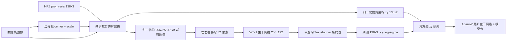

# DenseKP 训练审计

## 核心结论

DenseKP 训练是 CameraHMR 内部一项独立的二维关键点回归任务，**不会**训练 CameraHMR 的 SMPL/SMPL-X 网格回归器。模型使用类似 ViTPose-H 的 ViT 主干网络和 Transformer 解码器头，在裁剪图像坐标系中回归 138 个固定表面对应点。数据加载器要求二维监督信号已经以 `proj_verts` 字段的形式写入 NPZ 标注。

## 十项审计结论

1. **训练入口：** `tools/CameraHMR/train_keypoints.py`；文档中的命令为 `python train_keypoints.py data=densekp_train experiment=densekp exp_name=...`。对应的 Lightning 模块是 `core/densekp_trainer.py::DenseKP`。
2. **网络结构：** 由 `core/backbones/vit.py` 和 `core/heads/smpl_head_keypoints.py` 组成，暂存版本位于 `densekp/core/`。`core/densekp_model.py` 是一份不完整且无效的重复代码（`forward` 缺少 `:`），训练和推理均未导入它，因此没有复制到本仓库。
3. **模型头输入/输出：** 模型接收归一化后的 `[B,3,256,256]` 张量；沿宽度截取 `32:-32` 列后得到 `[B,3,256,192]`。主干网络输出通道优先、含 1280 个通道的 token 网格。模型头将网格展平，通过一个 6 层解码器（`dim=1024`、8 个注意力头）让一个学习得到的零查询 token 执行交叉注意力，最后由线性层输出 `[B,138,3]`。第 0:2 通道是归一化裁剪坐标 x/y（目标范围名义上为 `[-0.5,0.5]`）；当 `MODEL.with_var=true` 时，第 2 通道按 log sigma 训练。
4. **数据集/数据加载器：** 位于 `core/datasets/dataset_keypoints.py` 和 `datamodule_keypoints.py`。每个配置名称都在 `core/configs/__init__.py` 中映射到一个图像根目录和一个 NPZ 文件。训练数据集采用均匀拼接；虽然配置项名为 `DATASETS_AND_RATIOS`，但实际上没有实现按比例采样器。
5. **标注：** 实际读取的必需字段为 `imgname[N]`、`scale[N]`、`center[N,2]` 和 `proj_verts[N,138,3]`；极端裁剪决策还会使用 `part` 或 `gtkps`，否则用全零关节点代替。详见 [`DATA_FORMAT.md`](../data/DATA_FORMAT.md)。
6. **138 个点：** 点的身份由第 `0..137` 行的索引决定，训练标注已经包含这些行。仓库还包含形状为 `[138,10475]` 的 `densekp_regressor_R.npy`：第 `i` 行表示由 1–3 个顶点加权得到的 SMPL-X 表面点，所有行的权重和都约等于 1，非零系数总数为 204。**未知（UNKNOWN）：** 仓库中没有标注生成脚本可以证明已发布的 `proj_verts` 确实由该矩阵生成，也没有 138 行所对应人体部位的语义名称表。
7. **损失函数：** 启用方差时（随附配置的默认方式），每个点计算 `d2=1000*||gt_xy-pred_xy||^2` 和 `sigma=exp(clip(pred_log_sigma,min=log(1e-6)))`；损失为 `mean(d2/(2*sigma^2)) + mean(log(sigma^2))`，之后乘以 60。未启用方差时，损失为 xy 均方误差，同样乘以 60。真实标注的第 3 通道被忽略，且没有应用可见性掩码。
8. **依赖：** 训练运行时需要 PyTorch、Lightning、Hydra/OmegaConf、YACS、NumPy、OpenCV、scikit-image、albumentations、einops、timm、loguru、pyrootutils 和 rich。训练路径**不会**导入 Detectron2/DensePose。NPZ 标注生成后便不再需要 SMPL/SMPL-X；若要从人体参数生成新标注，则需要 SMPL-X，以及渲染器或投影代码。
9. **权重/配置/资源：** 从头训练时必须使用 `vitpose_backbone.pth` 初始化，该文件会被无条件加载。`densekp.ckpt` 是恢复训练/微调时的可选项。Hydra 配置和数据集注册表为必需项。生成与 SMPL-X 一致的监督信号时需要 `densekp_regressor_R.npy`，但读取已有 NPZ 时不需要。SMPL-X 模型文件和相机元数据属于标注生成阶段的资源。
10. **不属于重训练的内容：** `demo_keypoints.py`、检测器代码、`deploy/densekp_onnx`、`src/densekp_delivery`、ONNX/TRT 产物、pano-stitch 相机重映射/匹配、`CamSMPLify`、SingleFitting 和 `cpp/staged_lm` 均属于推理、部署或下游消费环节。

## 训练数据流

## 范围边界

| 模块 | 用途 | 是否纳入重训练暂存区？ |
|---|---|---|
| CameraHMR DenseKP 训练 | NPZ/图像加载、数据增强、ViT + 模型头、损失函数 | 是 |
| CameraHMR DenseKP 推理 | 检测器、裁剪、检查点前向传播、坐标还原 | 否 |
| ONNX/部署 | 导出、ORT/TRT、固定形状产物 | 否 |
| pano-stitch 交付 | 鱼眼/ERP 重映射、人物匹配、有效性、JSON | 否 |
| 拟合/C++ | 将 DenseKP 各行视为 SMPL-X 表面算子的观测值 | 否 |

## 审计警告与未知项

- 本地没有已发布的标注 NPZ，因此 `proj_verts` 第 3 通道的确切数据类型、范围和含义均为**未知（UNKNOWN）**。代码只能证明训练使用了 xy。
- `compute_loss` 没有对遮挡/截断应用掩码。已发布标注是否预先过滤了样本，或是否编码了可见性但被代码意外忽略，均为**未知（UNKNOWN）**。应使用 `tools/annotation/inspect_annotation.py` 检查官方标注。
- 138 行的语义名称和原始采样过程为**未知（UNKNOWN）**。矩阵仅精确提供顶点索引和权重，不提供人体解剖标签。
- 训练配置禁用了翻转和旋转，从而避开了一个潜在问题：`get_example_projverts` 会翻转图像，却不会对 `proj_verts` 执行对应的重排/翻转。在定义并测试 138 点的镜像置换关系之前，不要启用水平翻转。
- 上游推理将第 2 通道称为置信度/原始分数，而训练将其作为对数不确定性进行优化（sigma 越小表示确定性越高）。将其用作阈值前，必须测试其校准情况和数值方向。
- 上游验证会持续累积 `validation_step_output`，但不会在每轮结束时清空；暂存副本已经增加了清空操作。
